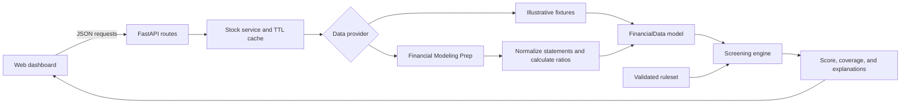

# FundamentalIQ

[](https://www.python.org/)
[](https://fastapi.tiangolo.com/)
[](https://github.com/kayiu9011/project3.1/actions/workflows/ci.yml)

FundamentalIQ is an explainable fundamental stock-screening application. It retrieves financial statements and company data from Financial Modeling Prep (FMP), converts them into a provider-neutral financial snapshot, and evaluates ten transparent screening rules.

The application is designed for research and education. Every result shows the underlying metric, threshold, outcome, explanation, and data coverage instead of presenting an unexplained score.

> **Disclaimer:** FundamentalIQ is not investment advice, a forecasting service, or a buy/sell recommendation. Its simplified thresholds may be unsuitable for particular companies, sectors, industries, and market conditions.

## Highlights

- Responsive stock-analysis dashboard built with vanilla JavaScript and Tailwind CSS
- FastAPI backend with typed Pydantic request and response models
- Financial Modeling Prep integration for statements, quotes, and company profiles
- Ten editable checks across profitability, valuation, stability, growth, and cash flow
- Coverage-aware scoring with an `Insufficient Data` state
- Clear explanations, strengths, concerns, and financial-sector warnings
- Five-minute in-process cache to reduce external API usage
- Offline mock mode with six fictional companies
- Automated provider, normalization, screening, and API tests
- API keys remain server-side and are excluded from Git

## How it works



The screening engine only consumes the normalized `FinancialData` model; it has no dependency on FMP or HTTP. Missing provider values remain `null` and reduce data coverage rather than silently becoming zero.

## Screening criteria

| Category | Checks | Default weight |
|---|---|---:|
| Profitability | Return on equity, return on assets, net margin, operating margin | 30% |
| Valuation | Price-to-earnings ratio | 20% |
| Financial stability | Debt-to-equity ratio, current ratio | 20% |
| Growth | Year-over-year quarterly revenue growth | 15% |
| Cash flow | Operating cash flow, free cash flow | 15% |

A passing check earns its available weight. Failed checks earn zero. Unavailable or structurally inappropriate checks are excluded from the available total.

```text
Normalized score = earned available points / total available points × 100
Data coverage    = total available points / 100 × 100
```

When weighted coverage is below 60%, the result is classified as `Insufficient Data`. Thresholds and category weights can be changed from the dashboard.

## FMP API usage

Each uncached ticker lookup makes five FMP requests:

1. Income statement
2. Balance-sheet statement
3. Cash-flow statement
4. Stock quote
5. Company profile

The normalized result is cached for 300 seconds by default. Repeating any stock or screening endpoint for the same ticker during that period makes no additional FMP requests. Provider access and financial-history limits depend on your [FMP subscription](https://site.financialmodelingprep.com/developer/docs).

FundamentalIQ maps FMP's `freeCashFlow` statement value into the existing free-cash-flow check. FMP defines this value as operating cash flow plus capital investment, where capital expenditure is normally negative.

## Technology

- Python 3.11+
- FastAPI and Uvicorn
- HTTPX
- Pydantic and pydantic-settings
- pytest and pytest-asyncio
- HTML5 and vanilla ES2022 JavaScript
- Tailwind CSS 3

## Project layout

```text
.
├── backend/
│   ├── app/
│   │   ├── api/routes/        # HTTP endpoints
│   │   ├── core/              # Environment settings
│   │   ├── models/            # Provider-neutral financial model
│   │   ├── providers/         # Mock and FMP adapters
│   │   ├── schemas/           # Screening request/response schemas
│   │   ├── screening/         # Rules and scoring engine
│   │   └── services/          # Caching and provider orchestration
│   ├── tests/                 # Automated backend tests
│   └── requirements.txt
├── frontend/
│   ├── src/css/               # Tailwind source
│   ├── src/js/                # Dashboard application
│   ├── build.mjs              # Production build script
│   └── index.html
├── .env.example
└── README.md
```

## Quick start

### 1. Clone and configure

```powershell
git clone https://github.com/kayiu9011/project3.1.git
Set-Location project3.1
Copy-Item .env.example .env
```

Add your FMP key to `.env`:

```dotenv
FMP_API_KEY=your_key_here
FMP_BASE_URL=https://financialmodelingprep.com/stable
DATA_PROVIDER_MODE=fmp
CACHE_TTL_SECONDS=300
MINIMUM_DATA_COVERAGE=60
```

### 2. Install the backend

```powershell
python -m venv .venv
.venv\Scripts\Activate.ps1
python -m pip install -r backend\requirements.txt
```

### 3. Build the frontend

```powershell
Set-Location frontend
npm.cmd install
npm.cmd run build
Set-Location ..
```

### 4. Run the application

```powershell
Set-Location backend
python -m uvicorn app.main:app --reload
```

Open the dashboard at <http://127.0.0.1:8000> or the interactive API documentation at <http://127.0.0.1:8000/docs>.

On Windows, after completing the installation, you can also double-click `start-app.bat` in File Explorer. The launcher starts the server on port `8001`, opens the dashboard in your default browser, and stops when you press `Ctrl+C` or close its terminal window.

To run this version beside another local project, select a different port:

```powershell
python -m uvicorn app.main:app --reload --port 8001
```

## Mock mode

The application can run without credentials or network access:

```dotenv
DATA_PROVIDER_MODE=mock
FMP_API_KEY=
```

Available fictional tickers are `NOVA`, `SKYH`, `IRON`, `BURN`, `PART`, and `FINX`. Mock companies are clearly marked as illustrative data and are not real issuers.

## API endpoints

| Method | Endpoint | Purpose |
|---|---|---|
| `GET` | `/api/health` | Application health and provider mode |
| `GET` | `/api/config/status` | Safe configuration readiness information |
| `GET` | `/api/stocks/{symbol}` | Normalized company snapshot |
| `GET` | `/api/stocks/{symbol}/screen` | Screen using default rules |
| `POST` | `/api/stocks/{symbol}/screen` | Screen using a validated custom ruleset |
| `GET` | `/api/screening/criteria` | Criteria metadata and default rules |

Example:

```bash
curl http://127.0.0.1:8000/api/stocks/AAPL/screen
```

## Testing

The test suite uses mocked HTTP responses and never consumes live FMP quota:

```powershell
Set-Location backend
python -m pytest -q
```

Tests cover normalization, calculated ratios, missing values, negative equity, provider authentication and rate limits, caching behavior, custom thresholds, coverage, and every API workflow.

## Security and data handling

- `.env` is ignored by Git and must never be committed.
- The FMP API key is only sent from the backend to FMP.
- Configuration endpoints expose readiness status, never credentials.
- Provider error responses are normalized before being returned to clients.
- Cached financial data is process-local and is cleared when the backend restarts.

## Current limitations

- Screening rules are general heuristics rather than sector-specific models.
- The cache is local to one process and is not shared across workers.
- The application does not persist watchlists or historical screens.
- Free cash-flow definitions can differ between data providers.
- Price and statement freshness depends on FMP's data and subscription tier.

## Roadmap

- Side-by-side company comparisons
- Sector-specific screening strategies
- Multi-year statement trends
- Watchlists and persistent screening history
- CSV and PDF exports
- Additional valuation methods
