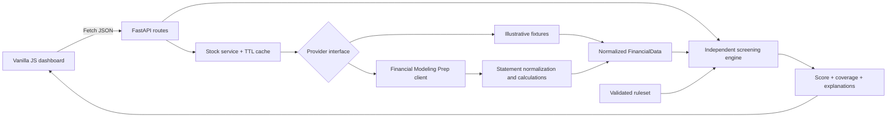

# FundamentalIQ

FundamentalIQ is a portfolio-quality fundamental stock screening application. It retrieves a normalized financial snapshot, evaluates ten transparent rules, and explains each pass, failure, or unavailable check. It also retains clearly labeled fictional companies in mock mode for use without credentials or network access.

> Educational research only. FundamentalIQ does not provide personalized investment advice, forecasts, or buy/sell recommendations. Simplified thresholds may be inappropriate for particular sectors, industries, business models, and development stages.

## Features

- FastAPI API with typed Pydantic request and response models
- Provider-neutral architecture with mock and optional Financial Modeling Prep providers
- FMP integration using quarterly financial statements, a quote, and a company profile, with calculated ratios
- Weighted, coverage-aware scoring with an `Insufficient Data` state
- Deterministic explanations, strengths, concerns, and financial-sector applicability warnings
- Six fictional fixtures covering healthy, expensive growth, leveraged, unprofitable, incomplete, and financial-sector cases
- Responsive vanilla JavaScript dashboard with accessible states and locally persisted custom thresholds
- Process-local five-minute TTL cache (configurable)
- Automated engine, provider, normalization, and API tests with no live credentials required

## Tech stack

- Python 3.11+, FastAPI, Uvicorn, HTTPX, Pydantic, pydantic-settings
- pytest, pytest-asyncio, FastAPI TestClient, HTTPX MockTransport
- HTML5, vanilla ES2022 JavaScript, Tailwind CSS 3 production build

## Architecture



External data passes through the selected provider into one normalized `FinancialData` model. Missing fields remain `null`. The Financial Modeling Prep provider combines quarterly income statements, balance sheets, cash-flow statements, a stock quote, and a company profile. It uses four complete quarters for trailing values and calculates ratios only from usable inputs. The screening engine knows nothing about HTTP or the selected provider.

## Project structure

```text
backend/
  app/
    api/routes/       FastAPI endpoints
    core/             environment settings
    models/           normalized internal financial model
    providers/        provider interface, mock fixtures, Financial Modeling Prep client
    schemas/          screening request/response models
    screening/        criteria catalog and independent engine
    services/         provider orchestration and TTL cache
    main.py            app factory, error handlers, static hosting
  tests/               engine, provider, and API tests
  requirements.txt
frontend/
  src/css/             Tailwind source
  src/js/              vanilla dashboard application
  index.html
  package.json         production CSS build workflow
.env.example
```

## Install and run

From the repository root on PowerShell:

```powershell
Copy-Item .env.example .env
py -3.11 -m venv .venv
.venv\Scripts\Activate.ps1
python -m pip install -r backend\requirements.txt
Set-Location frontend
npm.cmd install
npm.cmd run build
Set-Location ..\backend
uvicorn app.main:app --reload
```

Open <http://127.0.0.1:8000>. API documentation is available at <http://127.0.0.1:8000/docs>.

The frontend is compiled to `frontend/dist`, then served by FastAPI. Re-run `npm.cmd run build` after frontend changes. `npm.cmd run dev:css` can watch CSS during development; copy/build the HTML and JavaScript before using the integrated server.

### Mock mode

Mock mode remains available for offline development:

```dotenv
DATA_PROVIDER_MODE=mock
FMP_API_KEY=
```

Try `NOVA`, `SKYH`, `IRON`, `BURN`, `PART`, or `FINX`. Every name includes “Illustrative Sample,” uses the `SAMPLE` exchange, and is marked `is_mock: true`. Unknown tickers return 404 intentionally.

### Configure Financial Modeling Prep

The implementation follows the official [Financial Modeling Prep stable API documentation](https://site.financialmodelingprep.com/developer/docs). It combines `income-statement`, `balance-sheet-statement`, `cash-flow-statement`, `quote`, and `profile`. Each stock retrieval therefore consumes five provider requests before caching. Endpoint availability and history limits depend on your FMP subscription.

```dotenv
DATA_PROVIDER_MODE=fmp
FMP_API_KEY=your_key_here
FMP_BASE_URL=https://financialmodelingprep.com/stable
```

Restart the backend after changing environment values. `.env` is ignored by Git. The key is never returned by an endpoint or sent to the browser. If FMP mode lacks a key, stock endpoints return a clear 503 configuration error.

FundamentalIQ maps FMP's `freeCashFlow` statement field to its existing free-cash-flow check so the application architecture and response contract stay unchanged. FMP defines that field as operating cash flow plus capital investment (capital expenditure is normally negative); consult FMP's methodology when comparing it with providers that use a different levered-free-cash-flow definition.

## API

| Method | Endpoint | Purpose |
|---|---|---|
| GET | `/api/health` | Health and provider mode |
| GET | `/api/config/status` | Safe readiness information |
| GET | `/api/stocks/{symbol}` | Normalized company snapshot |
| GET | `/api/stocks/{symbol}/screen` | Default screen |
| POST | `/api/stocks/{symbol}/screen` | Screen with a validated ruleset |
| GET | `/api/screening/criteria` | Defaults, weights, units, and notes |

Example:

```bash
curl http://127.0.0.1:8000/api/stocks/NOVA/screen
```

Abbreviated response:

```json
{
  "company": { "symbol": "NOVA", "is_mock": true, "return_on_equity": 0.218 },
  "screening": {
    "score": 100.0,
    "classification": "Strong initial fundamentals",
    "data_coverage": 100.0,
    "passing_checks": 10,
    "failing_checks": 0,
    "unavailable_checks": 0,
    "metrics": []
  }
}
```

To customize a screen, fetch `/api/screening/criteria`, modify values within `ruleset.thresholds`, and POST the complete ruleset as JSON. Category weights must total exactly 100.

## Screening methodology

Default category weights are profitability 30, valuation 20, financial stability 20, growth 15, and cash flow 15. Weight is split equally among checks in each category. A pass earns its full allocated weight; a failure earns zero; unavailable or structurally inappropriate checks are excluded.

```text
Normalized score = earned available points / total available points × 100
Data coverage    = total available points / 100 × 100
```

Below 60% weighted coverage, the classification is `Insufficient Data`. Otherwise: 80–100 strong initial fundamentals; 60–79 generally favorable with areas to examine; 40–59 mixed; 0–39 multiple concerns. Display values are rounded to one decimal place.

P/E at or below zero fails rather than appearing cheap. Missing P/E is N/A. Debt/equity is N/A when negative equity is identifiable. General current-ratio and debt/equity checks are excluded for financial institutions. High ROE with excessive leverage receives a caution. Quarterly growth and levered free cash flow retain their precise labels.

These rules omit business quality, competitive position, cyclicality, accounting quality, capital allocation, valuation methods beyond P/E, forward estimates, and historical trends. They should begin research, not end it.

## Tests

```powershell
Set-Location backend
python -m pytest -q
```

Tests cover all-pass/all-fail/mixed scoring, missing metrics, negative earnings, statement-derived ratios, negative equity, financial-sector applicability, custom thresholds, weight validation, coverage, FMP JSON error payloads, mocked provider failures, and every API workflow. No test calls FMP over the network.

## Cache behavior

`CACHE_TTL_SECONDS=300` caches normalized snapshots in the current Python process to reduce provider calls. It is intentionally modest and has no persistence, cross-worker sharing, eviction policy beyond expiry, or freshness guarantee. A process restart clears it. Reporting periods are shown where available, and the UI labels price as “last available” rather than claiming real-time freshness.

## Roadmap (not implemented)

- Side-by-side comparisons and sector-specific strategies
- Genuine industry percentile datasets
- Multi-year statements and trends
- Watchlists, PostgreSQL persistence, and historical screening results
- CSV/PDF exports and additional valuation methods
- Stock-universe screening if provider coverage and rate limits permit

